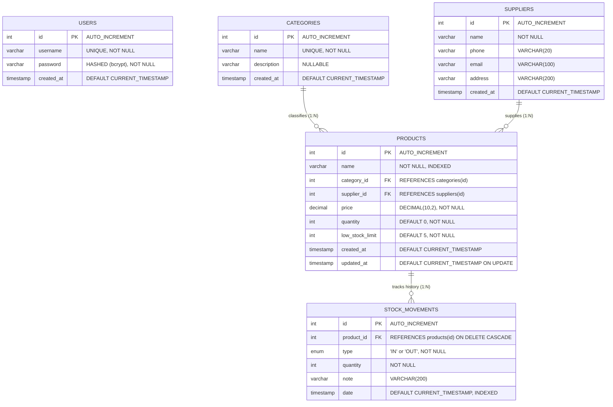

# Entity-Relationship (ER) Diagram & Database Architecture
## Inventory Management System (IMS)
**Prepared by:** Bhumika  
**Project Phase:** System Design (Phase 2)  
**Target Completion Date:** 30 September 2026  
**Document Version:** 2.0  

---

## 1. Relational ER Diagram (Crow's Foot Notation)

The database follows a normalized relational structure designed in MySQL 8.0 with InnoDB storage engine to guarantee referential integrity and transaction safety (ACID).

---

## 2. Entity Descriptions & Business Semantics

### 2.1 `users`
- **Purpose:** Stores authenticated system operators and administrative personnel.
- **Security:** Passwords are never stored in plain text; they are salted and hashed using bcrypt (10 rounds).
- **Cardinality:** Independent entity used for issuing stateless JSON Web Tokens (JWT).

### 2.2 `categories`
- **Purpose:** Organizes inventory products into logical domains (e.g., Stationery, Electronics, Furniture, Hardware, Books).
- **Referential Action:** When a category is deleted, referencing products have their `category_id` set to `NULL` (`ON DELETE SET NULL`), preventing orphaned records without deleting products.

### 2.3 `suppliers`
- **Purpose:** Stores vendor and distributor contact information for restocking procurement.
- **Referential Action:** When a supplier is deleted, product associations become `NULL` (`ON DELETE SET NULL`) while preserving inventory records.

### 2.4 `products`
- **Purpose:** Core catalog entity storing item name, pricing, current on-hand stock quantity, and minimum threshold limit.
- **Indexing:** B-Tree index on `name` (`idx_product_name`) and foreign key indexes enable fast queries across thousands of items.
- **Integrity Rule:** `quantity` is dynamically updated through atomic transactions executed whenever entries are inserted into `stock_movements`.

### 2.5 `stock_movements`
- **Purpose:** Append-only transaction ledger recording every unit addition (IN) or subtraction (OUT).
- **Referential Action:** Cascades on product deletion (`ON DELETE CASCADE`), ensuring historical logs are cleanly purged if a product is decommissioned.
- **Audit Columns:** Includes movement note/reason and timestamp for audit compliance and inventory reconciliation.

---

## 3. Structural Relationships Matrix

| Parent Table | Child Table | Foreign Key Column | Cardinality | ON DELETE Rule | ON UPDATE Rule | Business Rationale |
|---|---|---|---|---|---|---|
| `categories` | `products` | `products.category_id` | 1 to Many (1:N) | `SET NULL` | `CASCADE` | Products remain in catalog even if their category is deleted. |
| `suppliers` | `products` | `products.supplier_id` | 1 to Many (1:N) | `SET NULL` | `CASCADE` | Preserves product history if a supplier contract terminates. |
| `products` | `stock_movements` | `stock_movements.product_id` | 1 to Many (1:N) | `CASCADE` | `CASCADE` | Removing a product purges its associated movement history. |

---

## 4. Database Normalization Analysis

### 4.1 First Normal Form (1NF)
- All table attributes contain atomic, indivisible values (e.g., supplier phone and email are stored in separate, dedicated columns).
- Each table defines a dedicated unique Primary Key (`id INT AUTO_INCREMENT`).
- No repeating groups or multivalued attributes exist in any relation.

### 4.2 Second Normal Form (2NF)
- The schema satisfies 1NF.
- All non-key attributes are fully functionally dependent on the entire primary key (no partial functional dependencies exist because all primary keys are single-column identifiers).

### 4.3 Third Normal Form (3NF)
- The schema satisfies 2NF.
- There are no transitive dependencies ($X \rightarrow Y \rightarrow Z$).
- For example, Category Name is separated into `categories` instead of being stored inside `products`. Similarly, Supplier Address and Contact are placed in `suppliers`, ensuring modifications happen in a single place without update anomalies.