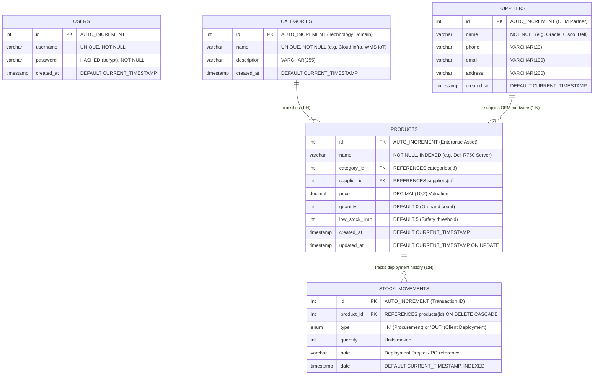

# Entity-Relationship (ER) Diagram & Database Architecture
## iONE IT Solutions – Enterprise Asset & Inventory Management (iONE IMS)
**Company:** iONE IT Solutions Pvt. Ltd. (Noida, India)  
**Author:** Bhumika (Full Stack Intern)  
**Supervisor:** Anshul Dogra  
**Phase:** System Design (Phase 2)  
**Version:** 3.0  

---

## 1. Relational ER Diagram (Crow's Foot Notation)

---

## 2. iONE Entity Semantics

- **`categories` (Technology Domains):** Groups assets according to iONE practice areas (Cloud & Server Infrastructure, Networking & Cybersecurity, Developer Workstations, Enterprise Software Licenses, iTRACE WMS IoT, and iHRMS Biometrics).
- **`suppliers` (OEM Partners):** Represents authorized technology partners including Oracle India, Dell Technologies, Cisco Systems India, Fortinet, and Zebra Technologies.
- **`products` (Enterprise Assets):** High-value infrastructure equipment, server blades, licenses, and developer machines tracked with unit prices and quantity.
- **`stock_movements` (Inward & Deployment Logs):** Immutable transactional records logging every inward procurement batch and client deployment to Central Ministries, PSUs, and enterprise go-lives.