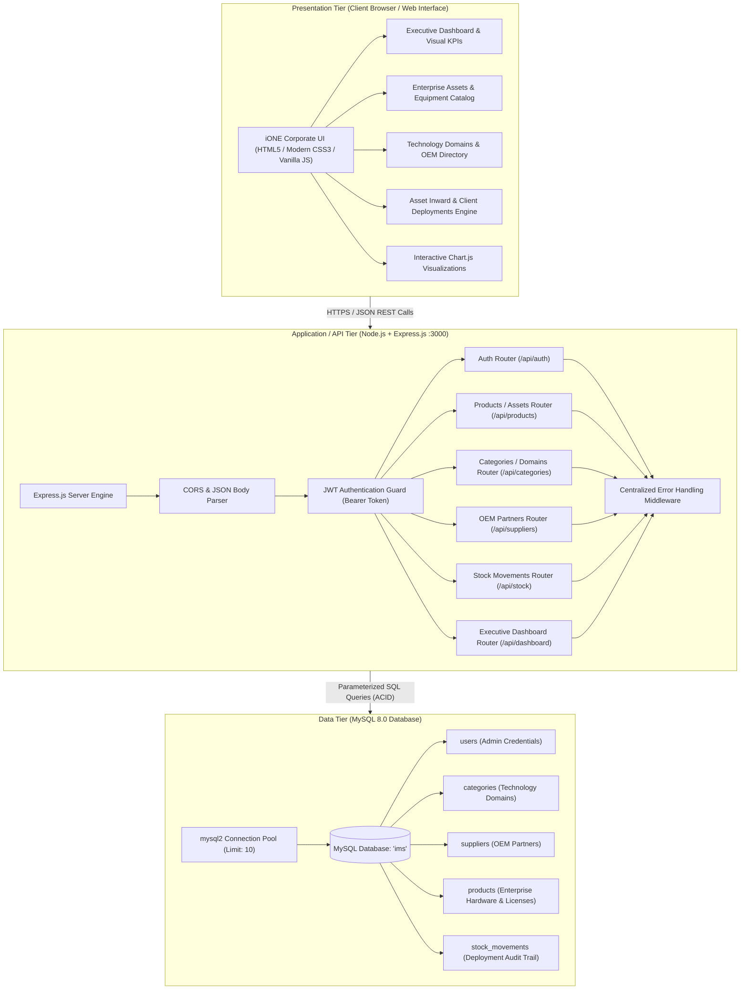
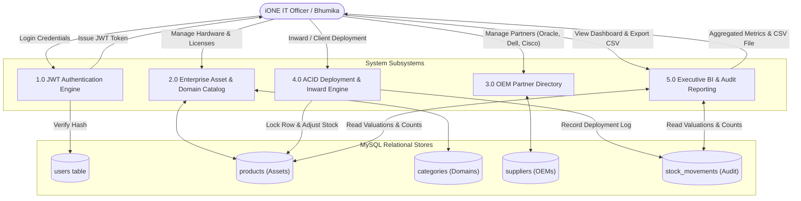
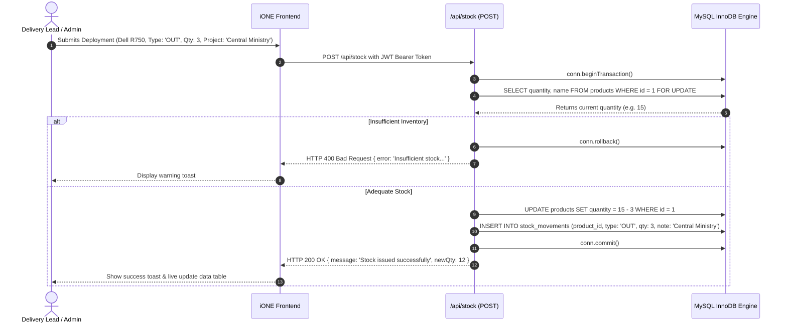

# System Design & Architecture Document
## iONE IT Solutions – Enterprise Asset & Inventory Management System (iONE IMS)
**Company:** iONE IT Solutions Pvt. Ltd. (Noida, India)  
**Author:** Bhumika (Full Stack Intern)  
**Supervisor / Mentor:** Anshul Dogra  
**Phase:** System Design (Phase 2)  
**Document Version:** 3.0  

---

## 1. 3-Tier Enterprise Architecture

The iONE IMS adopts a resilient 3-Tier architecture engineered to support high-value infrastructure management across iONE's Noida HQ, development centers, and client project deployments.

---

## 2. DFD Level 1 (iONE Deployment Flow)

---

## 3. Sequence Diagram (Client Project Deployment with ACID Lock)

---

## 4. RESTful API Specification

All protected endpoints require: `Authorization: Bearer <jwt_token>`

- `POST /api/auth/login` – Corporate admin authentication.
- `GET /api/products` – Retrieve enterprise equipment with filtering (`?search=&category_id=&supplier_id=&status=`).
- `POST /api/products` – Add new hardware / license asset.
- `PUT /api/products/:id` – Modify asset details.
- `DELETE /api/products/:id` – Decommission an asset.
- `GET /api/categories` – List technology domains with asset counts.
- `GET /api/suppliers` – List OEM partners (Oracle, Cisco, Dell, Zebra, etc.).
- `POST /api/stock` – Atomic asset inward (IN) or client project deployment (OUT).
- `GET /api/stock` – Historical deployment trail with date range filters.
- `GET /api/dashboard/summary` – Enterprise KPI aggregates ($\sum price \times qty$, low stock, supplier counts).
- `GET /api/dashboard/charts` – Inward vs deployment trends for Chart.js.
