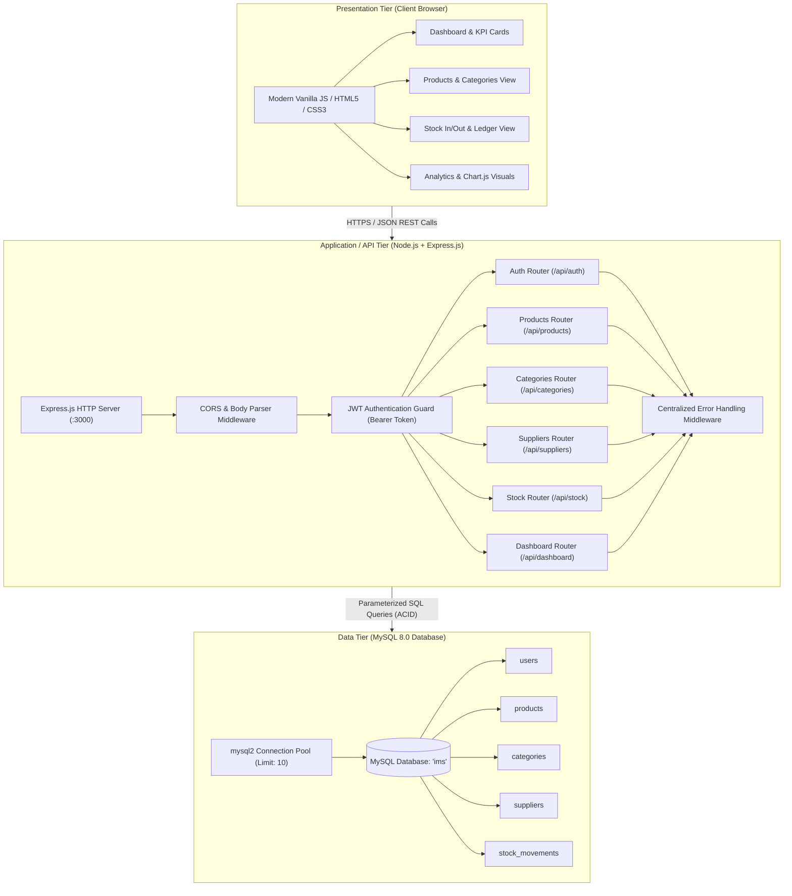
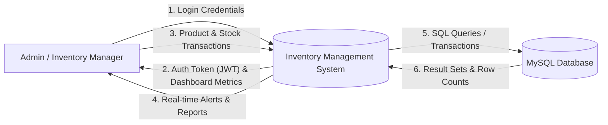
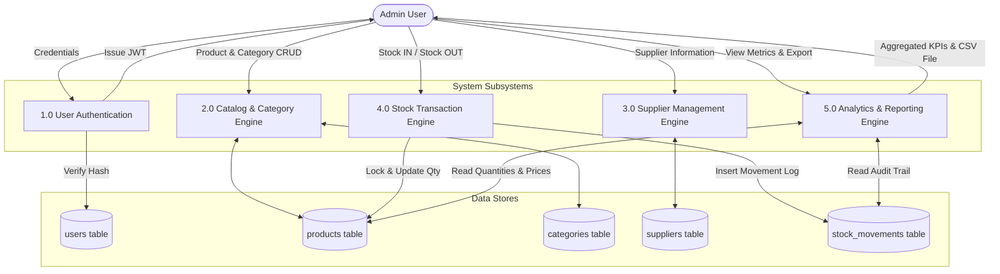
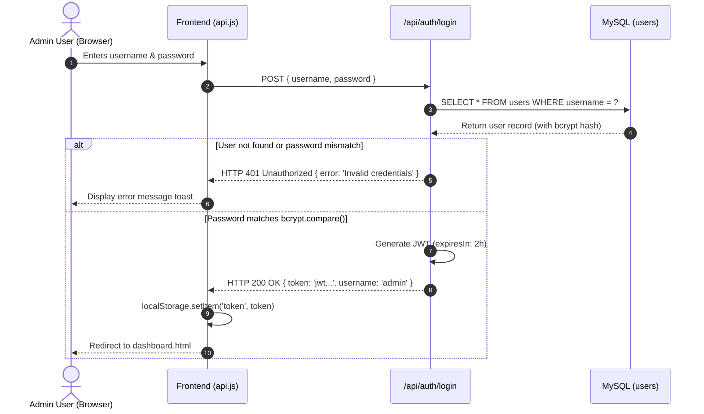
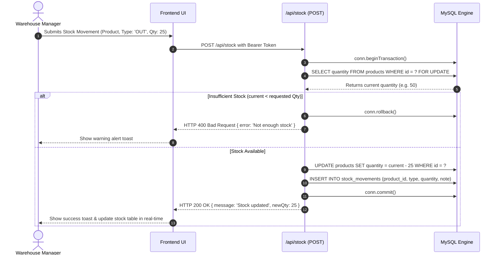

# System Design & Architecture Document
## Inventory Management System (IMS)
**Prepared by:** Bhumika  
**Project Phase:** System Design (Phase 2)  
**Target Completion Date:** 30 September 2026  
**Document Version:** 2.0  
**Supervisor / Reviewer:** Anshul Dogra  

---

## 1. System Architecture Overview

The Inventory Management System adopts a robust **3-Tier Client-Server Architecture** designed for high throughput, low latency, and clear separation of concerns.

---

## 2. Data Flow Diagrams (DFD)

### 2.1 DFD Level 0 (Context Level Diagram)
The Level 0 DFD illustrates external entities interacting with the boundaries of the IMS.

### 2.2 DFD Level 1 (Decomposed Functional Processes)

---

## 3. Sequence Diagrams (Key System Interactions)

### 3.1 Authentication & Token Issuance Flow
Illustrates secure administrative authentication using salted bcrypt verification and signed JSON Web Tokens.

### 3.2 Stock IN / OUT Transaction with ACID Rollback
Guarantees inventory consistency through atomic database transactions.

---

## 4. RESTful API Specification

All protected endpoints require an HTTP header:  
`Authorization: Bearer <jwt_token>`

| Method | Endpoint | Access | Request Body / Query Params | Expected Success Response | HTTP Status |
|---|---|---|---|---|---|
| `POST` | `/api/auth/login` | Public | `{ username, password }` | `{ token: "..." }` | 200 |
| `POST` | `/api/auth/register` | Public/Admin | `{ username, password }` | `{ message: "User created" }` | 201 |
| `GET` | `/api/products` | Protected | `?search=&category_id=&supplier_id=` | `[ { id, name, price, quantity, category, supplier, ... } ]` | 200 |
| `GET` | `/api/products/:id` | Protected | None | `{ id, name, price, quantity, ... }` | 200 |
| `POST` | `/api/products` | Protected | `{ name, category_id, supplier_id, price, quantity, low_stock_limit }` | `{ id: 10, message: "Product created" }` | 201 |
| `PUT` | `/api/products/:id` | Protected | `{ name, category_id, supplier_id, price, quantity, low_stock_limit }` | `{ message: "Product updated" }` | 200 |
| `DELETE` | `/api/products/:id` | Protected | None | `{ message: "Product deleted" }` | 200 |
| `GET` | `/api/categories` | Protected | None | `[ { id, name, product_count } ]` | 200 |
| `POST` | `/api/categories` | Protected | `{ name }` | `{ id: 4, message: "Category created" }` | 201 |
| `PUT` | `/api/categories/:id` | Protected | `{ name }` | `{ message: "Category updated" }` | 200 |
| `DELETE` | `/api/categories/:id` | Protected | None | `{ message: "Category deleted" }` | 200 |
| `GET` | `/api/suppliers` | Protected | None | `[ { id, name, phone, email, address, product_count } ]` | 200 |
| `POST` | `/api/suppliers` | Protected | `{ name, phone, email, address }` | `{ id: 2, message: "Supplier created" }` | 201 |
| `PUT` | `/api/suppliers/:id` | Protected | `{ name, phone, email, address }` | `{ message: "Supplier updated" }` | 200 |
| `DELETE` | `/api/suppliers/:id` | Protected | None | `{ message: "Supplier deleted" }` | 200 |
| `POST` | `/api/stock` | Protected | `{ product_id, type: 'IN'\|'OUT', quantity, note }` | `{ message: "Stock updated", newQty: 30 }` | 200 |
| `GET` | `/api/stock` | Protected | `?product_id=&type=` | `[ { id, product_name, type, quantity, note, date } ]` | 200 |
| `GET` | `/api/dashboard/summary` | Protected | None | `{ totalProducts, totalValuation, lowStockCount, totalSuppliers, totalCategories }` | 200 |
| `GET` | `/api/dashboard/charts` | Protected | None | `{ movementsTrend: [...], categoryDistribution: [...] }` | 200 |

---

## 5. Security Architecture & Threat Modeling

1. **Stateless Authentication:** JSON Web Tokens (JWT) signed with `HS256` algorithm and protected by a private secret in `.env`. Tokens expire in 2 hours.
2. **Password Cryptography:** User passwords are never saved in plain text. Hashed with bcrypt utilizing 10 salt rounds.
3. **Defense Against SQL Injection:** Strict parameterized queries across all database drivers (`db.query('... WHERE id = ?', [id])`), preventing arbitrary SQL injection attacks.
4. **Data Concurrency & Race Conditions:** Critical stock deductions use explicit row-level locking (`SELECT ... FOR UPDATE`) inside an ACID transaction block.
5. **Cross-Origin Resource Sharing (CORS):** Express server incorporates `cors()` middleware to regulate permitted client origins.
